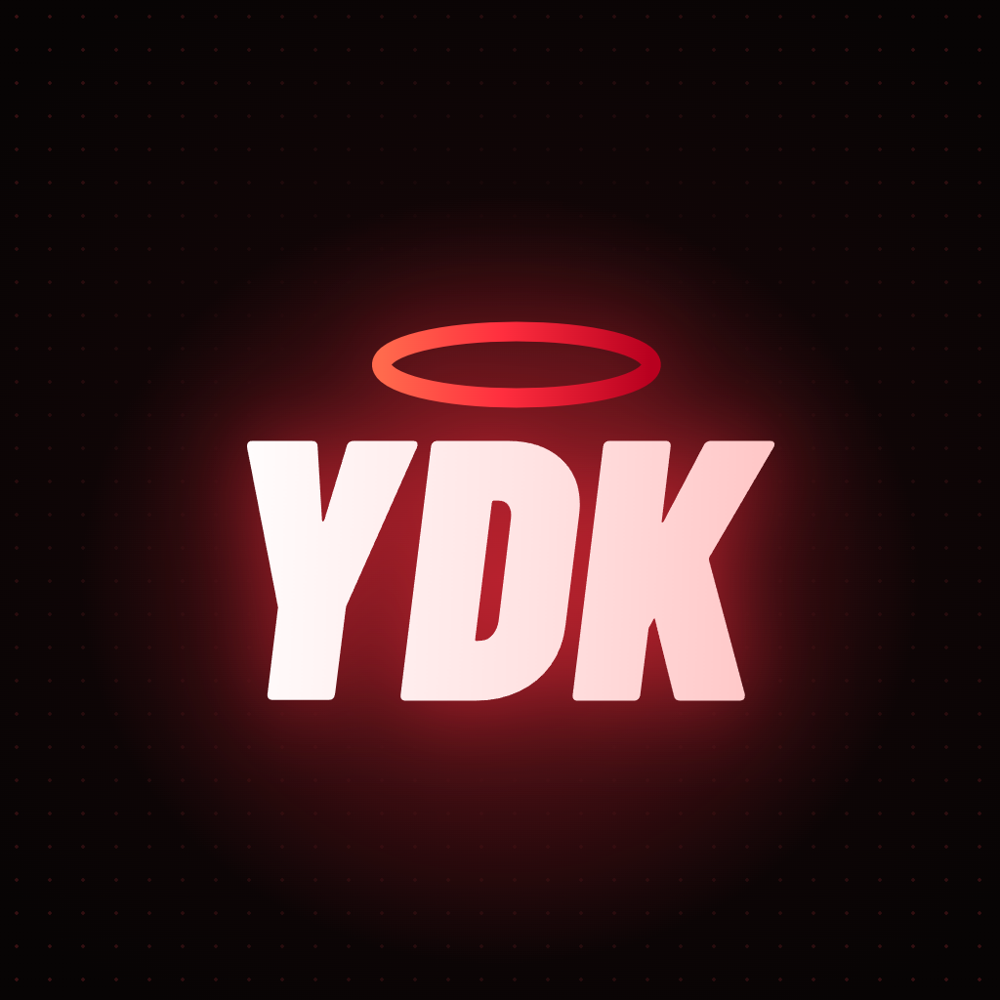

# Julian · Yardak

**Webs, tiendas online, apps y sistemas a medida para negocios de Paraná, Entre Ríos.**

Código propio, sin plantillas ni comisiones por venta, y cada proyecto probado en celus y compus antes de entregarlo.

[yardak.pages.dev](https://yardak.pages.dev) · [Instagram @ydk.exe](https://www.instagram.com/ydk.exe/) · [WhatsApp](https://wa.me/5493434727553)

## Con qué trabajo

-003B57?style=for-the-badge&logo=sqlite&logoColor=white)

## Proyectos para probar en vivo

| Proyecto | Qué hace | En vivo |
|---|---|---|
| [tienda-online](https://github.com/NEOYDK/tienda-online) | Tienda con talles, stock, Mercado Pago y envíos a todo el país | [Probalo](https://ydk-store.pages.dev) |
| [gimnasio-app-socios](https://github.com/NEOYDK/gimnasio-app-socios) | Web, app de socios con reservas y rangos, y panel con cuotas | [Probalo](https://gimnasio-demo-ydk.pages.dev) |
| [rotiseria-app-pedidos](https://github.com/NEOYDK/rotiseria-app-pedidos) | App de pedidos instalable y panel de la cocina en vivo | [Probalo](https://rotiseria-demo-ydk.pages.dev) |
| [whatsapp-pedidos-y-turnos](https://github.com/NEOYDK/whatsapp-pedidos-y-turnos) | Pedidos y turnos dentro de WhatsApp, con link de pago | [Probalo](https://whatsapp-demo-ydk.pages.dev) |
| [ferreteria-stock-ventas](https://github.com/NEOYDK/ferreteria-stock-ventas) | Stock y ventas con lector de códigos de barras | [Probalo](https://ferreteria-demo-ydk.pages.dev/sistema/) |
| [reformas-presupuestos](https://github.com/NEOYDK/reformas-presupuestos) | Presupuestos en PDF en 2 minutos | [Probalo](https://reformas-demo-ydk.pages.dev) |
| [maderera-corte-de-placas](https://github.com/NEOYDK/maderera-corte-de-placas) | Optimizador de corte de placas con plano y costo | [Probalo](https://maderera-demo-ydk.pages.dev) |
| [yardak](https://github.com/NEOYDK/yardak) | Mi web, con fondo animado en WebGL | [Probalo](https://yardak.pages.dev) |

Más demos: [barbería](https://github.com/NEOYDK/barberia-turnos), [consultorio](https://github.com/NEOYDK/consultorio-turnos), [inmobiliaria](https://github.com/NEOYDK/inmobiliaria-alquiler-por-dia) y [estudio contable](https://github.com/NEOYDK/estudio-contable).

## Buenas prácticas en todos los proyectos

HTTPS en todo · contraseñas cifradas (PBKDF2) · webhooks firmados (HMAC-SHA256) · consultas a la base parametrizadas · encabezados de seguridad · SEO con datos estructurados · accesibilidad revisada · pruebas automáticas
